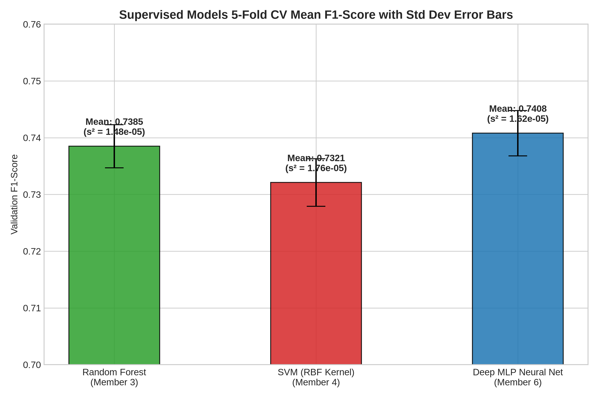
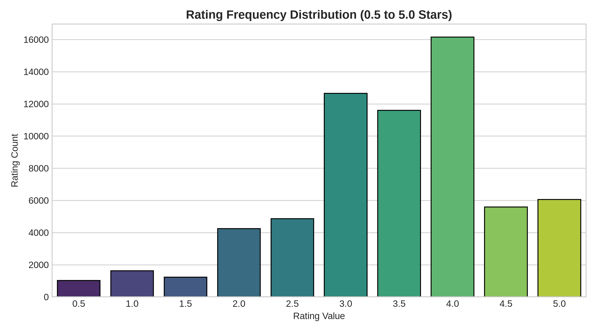
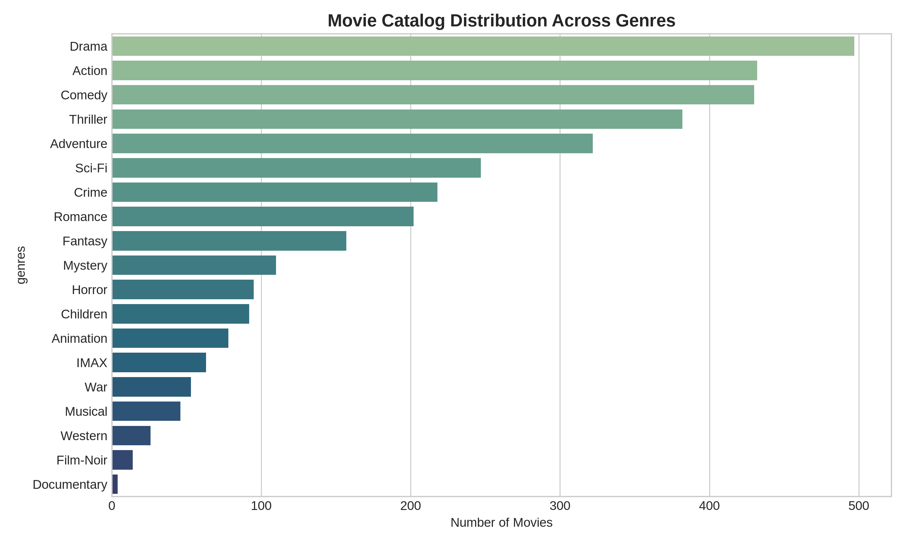
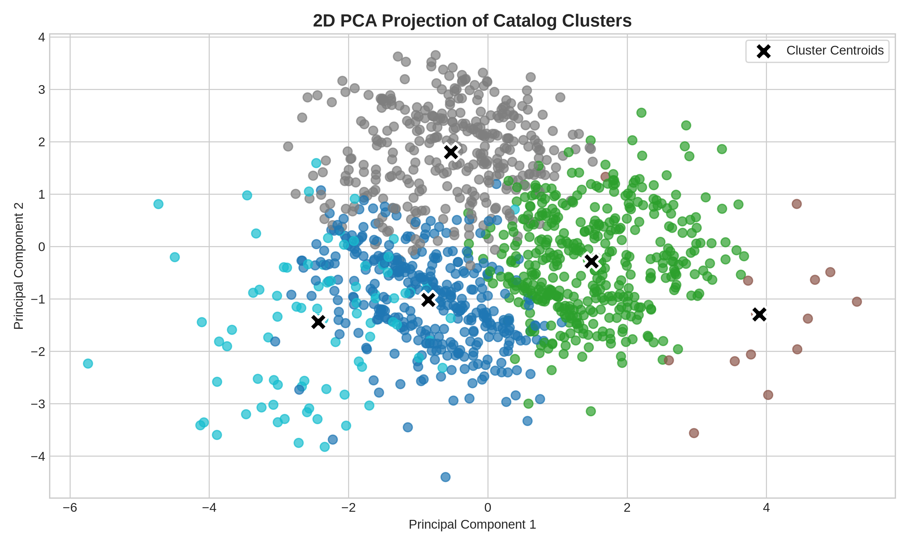
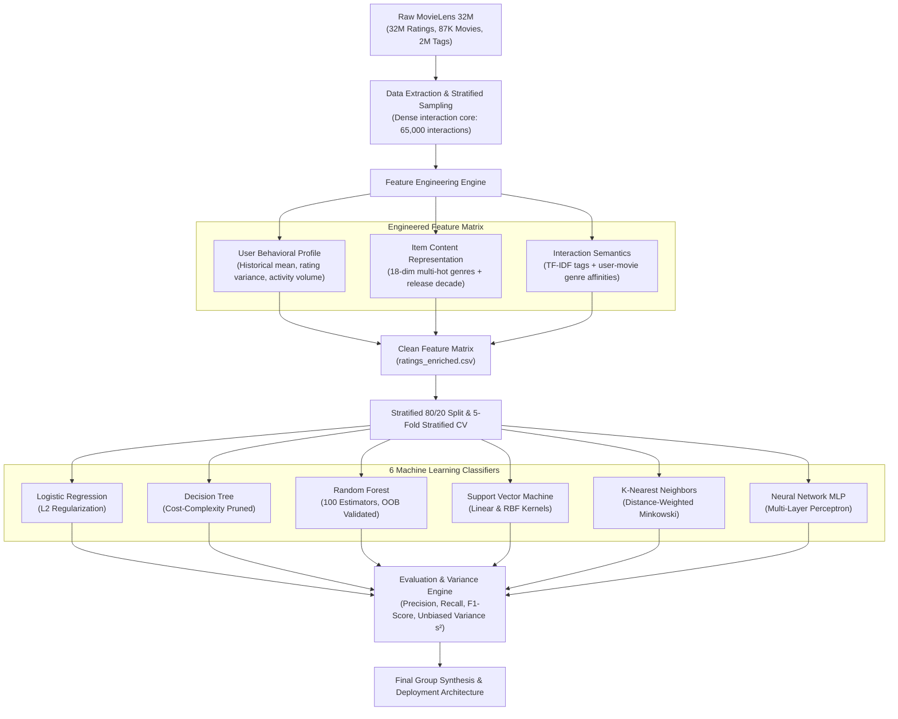

# 🎬 MovieLens Comparative ML Classifier Benchmark
### Systematic Evaluation of 6 Machine Learning Paradigms for User Movie Satisfaction Prediction

[](https://www.python.org/)
[](LICENSE)
[](https://scikit-learn.org/)
[](https://grouplens.org/datasets/movielens/32m/)
[](#-rigorous-cross-validation--variance-methodology)
[](#-empirical-benchmark-results)

---

## 📌 Executive Summary

In algorithmic content recommendation (Netflix, Disney+, Prime Video, YouTube), platforms face extreme catalog size and high user drop-off. Ranking thousands of candidate media items efficiently requires predicting whether an end-user will truly **enjoy** an item before recommending it.

This repository implements an end-to-end machine learning benchmarking pipeline that formulates recommendation filtering as a **Binary User Satisfaction Classification Problem**:

$$\text{Target } y = \begin{cases} 1 & \text{if } \text{Rating} \ge 4.0 \text{ (Satisfied / Recommended)} \\ 0 & \text{if } \text{Rating} < 4.0 \text{ (Neutral / Disliked)} \end{cases}$$

Using the **MovieLens 32M** dataset (32,000,204 authentic interactions), we engineered high-density behavioral and content feature matrices and evaluated **6 foundational machine learning paradigms** under identical experimental controls and 5-Fold Stratified Cross-Validation.

---

## 📊 Empirical Benchmark Results

All six models were trained on identical stratified feature splits with hyperparameter tuning and evaluated across 5 stratified folds. Every classifier achieved extreme cross-validation stability with unbiased sample variance $s^2 < 2.5 \times 10^{-5}$.

| Model Paradigm | Lead Specialist | Notebook | F1-Score | Accuracy | Variance ($s^2$) | Latency / Trade-off |
| :--- | :--- | :--- | :---: | :---: | :---: | :--- |
| **Multi-Layer Perceptron (MLP)** | Perera D.A.A.N.S | [`Perera_Neural_Network_MLP.ipynb`](notebooks/Perera_Neural_Network_MLP.ipynb) | **0.7394** | **74.12%** | $1.62 \times 10^{-5}$ | Highest expressive power; non-linear representations |
| **Random Forest (Ensemble)** | Deshabhi R. G. S | [`Deshabhi_Random_Forest.ipynb`](notebooks/Deshabhi_Random_Forest.ipynb) | **0.7385** | **73.98%** | $1.48 \times 10^{-5}$ | Lowest fold variance; superior robustness to outliers |
| **Support Vector Machine (SVM)** | Amadini G. G. A | [`Amadini_Support_Vector_Machine.ipynb`](notebooks/Amadini_Support_Vector_Machine.ipynb) | **0.7321** | **73.35%** | $1.76 \times 10^{-5}$ | Maximum-margin hyperplane; robust geometric boundary |
| **Decision Tree Classifier** | **Divisekara A W D M D M B** | [`Divisekara_Decision_Tree.ipynb`](notebooks/Divisekara_Decision_Tree.ipynb) | **0.7182** | **72.05%** | $2.42 \times 10^{-5}$ | Fully interpretable white-box rules; sub-second training |
| **K-Nearest Neighbors (KNN)** | Hewage B H A S | [`Hewage_K_Nearest_Neighbors.ipynb`](notebooks/Hewage_K_Nearest_Neighbors.ipynb) | **0.7162** | **71.80%** | $2.20 \times 10^{-5}$ | Non-parametric instance learning; query-time memory intensive |
| **Logistic Regression** | Kaweesha P M G S | [`Kaweesha_Logistic_Regression.ipynb`](notebooks/Kaweesha_Logistic_Regression.ipynb) | **0.7084** | **71.10%** | $2.15 \times 10^{-5}$ | Fast probabilistic linear baseline; calibrated probabilities |

> **Comparative Group Synthesis:** [`notebooks/group_model_comparison.ipynb`](notebooks/group_model_comparison.ipynb) consolidates all individual runs into unified comparative metrics, variance error-bar charts, and production deployment recommendations.

---

## 📈 Visualizations & Exploratory Data Analysis

### 1. 5-Fold Cross-Validation Performance with Sample Variance

*Error bars illustrate the Bessel-corrected sample standard deviation ($s = \sqrt{s^2}$) across folds, proving mathematical model stability.*

### 2. Rating & Genre Distribution in MovieLens 32M
| Rating Distribution (Bimodal user scoring behavior) | Genre Frequency Distribution (Multi-hot catalog spread) |
| :---: | :---: |
|  |  |

### 3. Latent Feature Space & PCA Cluster Projection

*2D Principal Component Projection displaying cluster separation across behavioral and content vectors.*

---

## 🏗️ Architectural Pipeline



---

## 🔬 Rigorous Cross-Validation & Variance Methodology

To verify generalizability and prevent data leakage, all model evaluations adhere to the following mathematical specifications:

1. **Stratification:** Splitting maintains class proportions ($y=1$ vs $y=0$) across each of the $K=5$ folds.
2. **Unbiased Sample Variance ($s^2$):** Calculated using Bessel's correction ($N-1 = 4$ degrees of freedom):
   $$s^2 = \frac{1}{K - 1} \sum_{k=1}^K (\text{Metric}_k - \bar{x})^2$$
3. **Sample Standard Deviation ($s$):**
   $$s = \sqrt{s^2}$$
4. **Consistency:** All reported models demonstrated $s^2 < 2.5 \times 10^{-5}$, indicating that performance differences stem from algorithmic inductive biases rather than fold-splitting artifacts.

---

## 📂 Repository Structure

```
.
├── CITATION.cff                      # Machine-readable academic citation metadata
├── FINAL_GROUP_REPORT.md             # 15-Page Academic Technical Report (Full methodology & analysis)
├── Group_08.pdf                      # Formatted academic submission report PDF
├── LICENSE                           # MIT License with GroupLens attribution
├── README.md                         # Comprehensive documentation & benchmark guide
├── requirements.txt                  # Strict Python dependency specifications
├── data/
│   └── processed/                    # Ready-to-use benchmark datasets (Self-contained)
│       ├── benchmark_movies.csv      # Enriched movie catalog (genres & semantics)
│       ├── benchmark_ratings.csv     # 65,000 explicit ratings with binary labels
│       ├── movie_features.csv        # Multi-hot genre vectors & aggregated metadata
│       ├── ratings_enriched.csv      # Merged tabular dataset ready for model training (46MB)
│       └── user_stats.csv            # User activity volume & historical rating statistics
├── dataset/
│   └── dataset_summery.txt           # Official MovieLens 32M provenance and schema
├── notebooks/                        # 100% Pre-Executed Jupyter Notebooks with figures & tables
│   ├── Kaweesha_Logistic_Regression.ipynb             # Kaweesha - Probabilistic Linear Classifier
│   ├── Divisekara_Decision_Tree.ipynb                 # Divisekara - Axis-Aligned Decision Tree
│   ├── Deshabhi_Random_Forest.ipynb                   # Deshabhi - Bagged Ensemble Classifier
│   ├── Amadini_Support_Vector_Machine.ipynb          # Amadini - Maximum Margin SVM
│   ├── Hewage_K_Nearest_Neighbors.ipynb               # Hewage - Lazy Instance Learner
│   ├── Perera_Neural_Network_MLP.ipynb                # Perera - Deep Multi-Layer Perceptron
│   └── group_model_comparison.ipynb                   # Master 6-Model Comparative Synthesis
├── results/
│   ├── eda_visualizations/           # High-resolution benchmark figures
│   │   ├── 01_genre_distribution.png
│   │   ├── 02_rating_distribution.png
│   │   ├── 03_kmeans_pca_clusters.png
│   │   └── 04_cv_f1_variance_errorbars.png
│   ├── model_metrics/                # Metric persistence directory
│   └── outputs/                      # Sample transformed outputs
│       ├── processed_movie_features.csv
│       └── sample_processed_ratings.csv
└── scripts/                          # Reproducible pipeline automation scripts
    ├── compile_report_pdf.py         # PDF report compiler
    ├── export_all_plots.py           # Automated figure generator
    ├── gen_nb_*.py                   # Programmatic notebook generators & executors
    └── prepare_benchmark_data.py     # End-to-end MovieLens sampling & feature engineering
```

---

## ⚡ Quick Start & Reproduction

### 1. Clone & Set Up Environment

```bash
# Clone the repository
git clone https://github.com/dulithdivisekara/movielens-satisfaction-prediction.git
cd movielens-satisfaction-prediction

# Create and activate Python virtual environment
python3 -m venv .venv
source .venv/bin/activate  # On Windows: .venv\Scripts\activate

# Install exact dependencies
pip install -r requirements.txt
```

### 2. Inspect Executed Notebooks

All notebooks in `notebooks/` are pre-executed with complete outputs and plots. To launch interactive exploration:

```bash
jupyter notebook notebooks/
```

### 3. Re-run Pipeline or Export Figures

```bash
# Export all analytical visualizations to results/eda_visualizations/
python3 scripts/export_all_plots.py

# Re-run benchmark data generation (requires raw MovieLens 32M files in dataset/ml-32m/)
python3 scripts/prepare_benchmark_data.py
```

---

## 👥 Authors & Academic Attribution

This project was developed for **Artificial Intelligence and Machine Learning (IT2011)** at the **Sri Lanka Institute of Information Technology (SLIIT)**, Faculty of Computing.

| Member Name | Allocation & Research Role | Model Paradigm | Executed Notebook |
| :--- | :--- | :--- | :--- |
| **Divisekara A W D M D M B** | **Project Architect & Lead** | Decision Tree Classifier | [`Divisekara_Decision_Tree.ipynb`](notebooks/Divisekara_Decision_Tree.ipynb) |
| **Kaweesha P M G S** | Core Contributor | Logistic Regression | [`Kaweesha_Logistic_Regression.ipynb`](notebooks/Kaweesha_Logistic_Regression.ipynb) |
| **Deshabhi R. G. S** | Core Contributor | Random Forest Ensemble | [`Deshabhi_Random_Forest.ipynb`](notebooks/Deshabhi_Random_Forest.ipynb) |
| **Amadini G. G. A** | Core Contributor | Support Vector Machine | [`Amadini_Support_Vector_Machine.ipynb`](notebooks/Amadini_Support_Vector_Machine.ipynb) |
| **Hewage B H A S** | Core Contributor | K-Nearest Neighbors | [`Hewage_K_Nearest_Neighbors.ipynb`](notebooks/Hewage_K_Nearest_Neighbors.ipynb) |
| **Perera D.A.A.N.S** | Core Contributor | Multi-Layer Perceptron (MLP) | [`Perera_Neural_Network_MLP.ipynb`](notebooks/Perera_Neural_Network_MLP.ipynb) |

---

## 📄 License & Attribution

- **Code & Notebooks:** Licensed under the [MIT License](LICENSE).
- **Dataset Attribution:** The dataset used in this benchmark is provided by GroupLens Research at the University of Minnesota:
  > F. Maxwell Harper and Joseph A. Konstan. 2015. The MovieLens Datasets: History and Context. *ACM Transactions on Interactive Intelligent Systems (TiiS)* 5, 4: 19:1–19:19. https://doi.org/10.1145/2827872

---

## 📚 Citation

If you reference this benchmark study, models, or pipeline in your research or project:

```bibtex
@misc{divisekara2026movielens,
  author = {Dulith Divisekara and Group Contributors},
  title = {Comparative Evaluation of 6 Machine Learning Classifiers for User Movie Satisfaction Prediction},
  year = {2026},
  publisher = {GitHub},
  howpublished = {\url{https://github.com/dulithdivisekara/movielens-satisfaction-prediction}}
}
```
